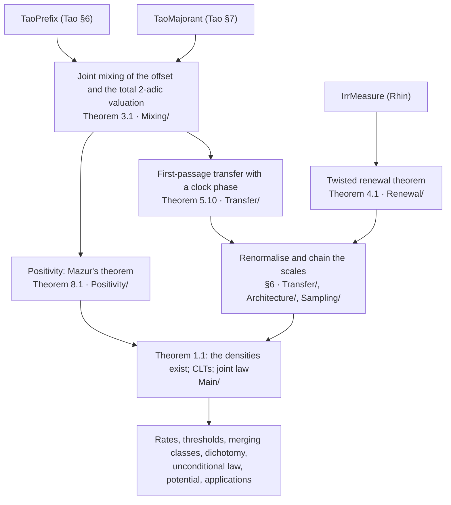

# Central limit theorems for Collatz hitting times (Lean 4 Formalization)

This repository formalizes, in Lean 4 with Mathlib, natural-density central limit theorems for the
hitting times of the Collatz map and two of its accelerations, together with corollaries and
applications. A companion paper is in preparation.

Every theorem is proved in Lean from three explicitly stated hypotheses, which record published
results that are not formalized here (see [Hypotheses](#hypotheses)). Lean's kernel checks each presented
proof using only the three standard axioms: `propext`, `Classical.choice` and
`Quot.sound`.

## The results

Write `T(n) = n/2` for even `n` and `T(n) = 3n + 1` for odd `n`; `F(n) = n/2` or `(3n + 1)/2`; and
`U(n) = (3n + 1)/2^{v₂(3n + 1)}`, the odd-to-odd map. For a target `b`, `P_G(b)` is the set of
positive `n` whose `G`-orbit reaches `b` (odd `n` only, for `U`), and `τ_{G,b}(n)` is the number of
steps it takes. With `c = log(4/3)`, the centring constants are `κ_T = 3/c`, `κ_F = 2/c` and
`κ_U = 1/c`, and the variance constants are `V_T = 2 (log 6)²/c³`, `V_F = 2 (log 3)²/c³` and
`V_U = 2 (log 2)²/c³`.

The headline theorems, all in namespace `CollatzCLT`:

| Lean name | Content |
|---|---|
| `density_pos` | For `3 ∤ b`, `P_T(b)` and `P_F(b)` have positive natural density. |
| `clt_T`, `clt_F` | For `3 ∤ b` and `N_X` uniform on `P_G(b) ∩ [1, X]`, `(τ_{G,b}(N_X) − κ_G log N_X) / √(V_G log X)` converges in law to `N(0, 1)`. |
| `clt_U` | The same for the odd clock, with `b` odd, `3 ∤ b`, and `N_X` uniform on `P_U(b) ∩ [1, X]`. |
| `joint_clocks` | For odd `b` with `3 ∤ b`, the three clocks `(τ_U, τ_F, τ_T)`, centred and divided by `√(log X)`, converge jointly in law to `√(2/c³) (log 2, log 3, log 6) Z` with `Z ~ N(0, 1)`. |
| `clt_T_variants`, `clt_F_variants`, `clt_U_variants`, `joint_clocks_variants` | The same limits for sampling on `[X, 2X]`, and with `log X` in place of `log N_X` in the centring. |
| `rates_T`, `rates_F`, `rates_U` | Sharp hitting rates: the densities of `{n ∈ P_G(b) : τ_{G,b}(n) ≤ c₀ log n}` and of related sets. |
| `dichotomy` | The set `E` of positive integers whose `T`-orbit never reaches 1 has a density below 1, positive if `E` is nonempty; its points `b` with `3 ∤ b` satisfy the conclusions of `density_pos` and `clt_T`; the basin of every cycle has positive density and an entry-time CLT; and every divergent ray has limit laws for its first entry. |
| `unconditional` | A CLT, valid for all positive integers without assuming the Collatz conjecture, for the time to enter a reference orbit of the merging class (`refChoice_exists` and `ref_change` are the two lemmas it relies on). |
| `potential` | The predecessor-density potential `h(n) = dens P_T(n)`: it exists, is positive iff `3 ∤ n`, satisfies a flow identity, decays along backward rays, is approximated by finite orbit potentials, and tends to 0 iff every orbit is eventually periodic. |
| `fixedfreq` | Decay of the twisted renewal kernel at a fixed frequency `2πr/Q₀`. |
| `anticonc` | Anti-concentration of the clocks on `P_G(b)`, and of the spatial coordinates of divergent classes. |
| `escape` | Deterministic-time escape from a divergent class. |
| `harmonicfirsthit` | Bounds for first-hit harmonic sums. |
| `modq` | Equidistribution of the hitting times modulo `Q₀`. |

The precise statements are in `LeanClt/Statements.lean`, except the last five, which are stated in
their own files (`Renewal/FixedFreq.lean`, `Applications/AntiConc.lean`, `Applications/Escape.lean`,
`Applications/Harmonic.lean`, `Applications/ModQ.lean`), and `refChoice_exists` and `ref_change`
(`Exceptional/Orbits.lean`). Each docstring explains the statement clause by clause, and the module
docstring of `Statements.lean` records the modelling choices: how convergence in law is expressed,
whether `X` is an integer or a real, and so on.

## How the proof fits together



Theorem and section numbers refer to the companion paper.

1. **Joint mixing** (Theorem 3.1, `jointMixing_of_tao`, `Mixing/`). From Tao's two estimates: in the geometric model (iid `Geom(2)` valuations), the 3-adic offset of the random affine map mixes at fine scales jointly with its total 2-adic valuation. Their joint law, with the offset taken modulo `3^n`, barely changes when the offset is averaged over the residues that agree with it modulo `3^m`: the change is at most `C_A m^{−A}` in L¹, for every `A`.
2. **Transfer** (Theorem 5.10, `transfer_of_tao`, `Transfer/`). Take `N` uniform on the odd integers of `[Y, 2Y]` and follow its orbit until it first drops below a threshold `x`. Joint mixing reduces that first passage to the geometric random-walk model, with the elapsed clock carried along as a Fourier phase `e^{isτ}`. The approximation holds uniformly for `Y` in `[x^α, x^{α²}]`. This step uses no Diophantine input.
3. **Twisted renewal** (Theorem 4.1, `twisted_renewal`, `Renewal/`). The model's kernel is a renewal sum for the walk `S_t log 2 − t log 3`, twisted by the phase. It is evaluated at small frequencies by equidistributing the fractional parts of `t log₂ 3`. This is where Rhin's irrationality measure enters, through the rotation discrepancy bound (Lemma 2.7).
4. **Chaining the scales** (§6; `Transfer/Adjacent.lean`, `Architecture/`, `Sampling/`). After renormalisation, the main term is the same at neighbouring scales, so chaining the scales controls the change from one scale to the next. This gives the existence of the densities and Gaussian characteristic functions together. Lévy's continuity theorem gives the CLT. A dyadic decomposition passes from odd sources on `[Y, 2Y]` to all integers in `[1, X]`.
5. **Positivity** (Theorem 8.1, `positivity_of_tao`, `Positivity/`). This is Mazur's theorem, proved here following his strategy. Its only input is (8.1), the L¹ form of Tao's fine-scale mixing (Proposition 1.14), which the Lean development derives from Theorem 3.1.
6. **Assembly and consequences.** `Main/` combines steps 4 and 5 into Theorem 1.1 and the sharp rates (Corollary 1.2). `Exceptional/` adds thresholds, merging classes and divergent rays, the dichotomy and the unconditional law. `Potential/` adds the predecessor-density potential. `Applications/` and `Renewal/FixedFreq.lean` hold the anti-concentration, escape, harmonic-sum and residue results. Of these, `anticonc` and `harmonicfirsthit` need only steps 1–2 together with an exact kernel bound, and `fixedfreq` needs only Rhin's measure.

## Prior work and credit

* **The Gaussian law as a prediction.** Lagarias and Weiss predicted a Gaussian law for the total stopping time from stochastic models ([*The 3x+1 problem: two stochastic models*](https://doi.org/10.1214/aoap/1177005779), Ann. Appl. Probab. 1992). Borovkov and Pfeifer proved it for the random-walk surrogate (*Estimates for the Syracuse problem via a probabilistic model*, Theory Probab. Appl. 45, 2001). Kontorovich and Lagarias established Gaussian behaviour of the actual 2-adic valuation sums over a fixed number of steps ([*Stochastic models for the 3x+1 and 5x+1 problems*](https://arxiv.org/abs/0910.1944), §5). The centring and variance constants are those of these models. What is new here is the law for the hitting times of actual integers.
* **Tao** ([*Almost all orbits of the Collatz map attain almost bounded values*](https://arxiv.org/abs/1909.03562), Forum Math. Pi 2022) proved that almost all orbits attain almost bounded values, in logarithmic density. He did so through a Fourier decay bound for Syracuse random variables (his Proposition 1.17) and a fine-scale mixing property of their offsets (his Proposition 1.14). `TaoMajorant` and `TaoPrefix` are taken from his §7 and §6.
* **Allikvere** ([*Almost all Collatz orbits attain almost bounded values in natural density*](https://zenodo.org/records/21499244), July 2026) proved the natural-density analogue of Tao's theorem. He did it by conditioning Tao's estimates on the total valuation. The key observation, that the total valuation is measurable with respect to the pair sums of Tao's §7, is his. Theorem 3.1 here is an averaged variant of his Theorems 3.1 and 4.1. The transfer of Theorem 5.10 extends the framework of his Theorem 6.1 to dyadic source intervals, arbitrary subsets of the backtracked set, uniformity in the scale, and a clock phase.
* **Mazur** independently proved a natural-density version with an explicit time bound ([*Natural-density almost-bounded Collatz orbits in logarithmic time*](https://proofatlas.ai/formalizations/natural-density-log-time-collatz/), July 2026). He also proved that a positive lower density of integers reach 1 within 10.46·log n steps ([*Explicit positive-density Collatz convergence in logarithmic time*](https://www.proofatlas.ai/formalizations/positive-density-log-time-collatz/), September 2026). Finally, he proved that for every `a` with `3 ∤ a` the predecessors of `a` have positive lower density ([*Positive lower density of Collatz predecessors*](https://www.proofatlas.ai/formalizations/positive-lower-density-collatz-predecessors/), September 2026). **The positivity of the densities in Theorem 1.1, Theorem 8.1 here, is Mazur's theorem, and priority for it rests with him.** The proof in `Positivity/` follows his strategy and construction. It is included so that the development depends only on Tao's estimates and Rhin's measure. Mazur's own results are formalized in Lean on ProofAtlas.
* **Shaik** ([*Positive density of Collatz convergence at every rate above 3/log(4/3)*](https://doi.org/10.5281/zenodo.22871622), September 2026) proved positive lower density of convergence at every rate above `κ_T = 3/log(4/3)`, with effective constants. Building on Mazur's inverse-trajectory framework, the same work gives a second proof of positivity. Shaik also obtained natural-density descent results with logarithmic passage times (SSRN 7290240 and 7341398).
* **Rhin**'s effective irrationality measure for `log₂ 3` is also used by Allikvere and Mazur. The exact flow identity of Theorem 1.4 is classical in counting form, through the work of Krasikov, of Applegate and Lagarias, and of Wirsching. What is new here is that it holds exactly for the limiting densities.

Prior results do not demonstrate he distribution of the hitting time of actual integers. Additions provided by this work include that natural densities exist; the central limit theorems and the joint law of the three clocks; the exact densities at every logarithmic rate, including the critical rate; the predecessor-density potential; and the downstream applications. Three new ingredients are leveraged: a first-passage transfer that keeps the elapsed time as a phase, a twisted renewal theorem, and a renormalisation that cancels the main term between neighboring scales.

## Hypotheses

Three external results enter as explicit hypotheses. They are definitions of type `Prop`, passed to
each theorem as arguments, not axioms, so every statement shows exactly which of them it assumes.

* `TaoMajorant` and `TaoPrefix` (`LeanClt/Mixing/Imports.lean`): two estimates from T. Tao, *Almost
  all orbits of the Collatz map attain almost bounded values*, Forum Math. Pi **10** (2022), e12
  (arXiv:1909.03562). `TaoPrefix` is stated in a form weaker than the corresponding estimate, so
  assuming it is no stronger; the module docstring gives the precise correspondence. Both were
  compared clause by clause with §6 and §7 of arXiv:1909.03562v7.
* `IrrMeasure d ϰ` (`LeanClt/Renewal/Defs.lean`): `‖h log₂ 3‖ ≥ d h^{−ϰ}` for every integer `h ≥ 1`,
  with `d > 0` and `ϰ ≥ 1`, where `‖·‖` is the distance to the nearest integer. Such constants exist
  by G. Rhin, *Approximants de Padé et mesures effectives d'irrationalité*, Séminaire de Théorie des
  Nombres, Paris 1985–86, Progr. Math. **71**, Birkhäuser, 1987, 155–164.

`fixedfreq` takes `IrrMeasure` only; `anticonc` and `harmonicfirsthit` take the two Tao hypotheses
only; `refChoice_exists` and `ref_change` take none; every other headline theorem takes all three.

## Verifying

You need [elan](https://github.com/leanprover/elan), the Lean toolchain manager. The toolchain
(Lean `v4.35.0-rc4`) and Mathlib (`v4.35.0-rc4`) are pinned in `lean-toolchain`, `lakefile.toml`
and `lake-manifest.json`. From a clone of this repository:

```
lake exe cache get                    # download prebuilt Mathlib
lake build                            # build the library LeanClt
lake env lean tests/Verbatim.lean     # frozen statements and definitions; expect no errors
lake env lean tests/Axioms.lean       # axioms of the 22 headline theorems
```

Building the library itself, after the Mathlib download, takes several minutes.

`tests/Axioms.lean` prints the axioms of each headline theorem and fails if any is not one of the
standard three, so a `sorry` or a `native_decide` anywhere in a proof would be caught.

The build reports 158 warnings and no errors. Most are deprecation notices for Mathlib lemmas and
tactics renamed since the code was written; the rest come from style linters (unused `simp`
arguments, unused variable names and the like) and from Lean's new module system. Warnings do not
affect what Lean's kernel checks: the output of `tests/Axioms.lean` is what matters.

## Fidelity

A reader who wants to confirm that the code correctly formalizes the proposed theorems is encouraged to check:

1. **The statements**: each of the 22 theorems listed above.
2. **The definitions they unfold to**: 68 definitions of this library, in 13 files. Followed
   through definition bodies (not through proofs), the statements reach `Defs.lean`,
   `Main/VariantDefs.lean`, `Renewal/Defs.lean`, `Mixing/Imports.lean`, `Transfer/Defs.lean`,
   `Transfer/Typical.lean`, `Elementary/Affine.lean`, `Elementary/Flow.lean`,
   `Exceptional/Defs.lean`, `Exceptional/Rays.lean`, `Potential/Defs.lean`,
   `Applications/Coordinates.lean` and `Applications/AntiConc.lean`. For convenience,
   `tests/Verbatim.lean` copies 62 of them, character for character and in dependency order, checks
   each copy against the library by `rfl`, and restates all 22 theorems; the six not copied are in
   `Renewal/Defs.lean` and `Transfer/Defs.lean`.
3. **The hypotheses**: that `TaoMajorant`, `TaoPrefix` and `IrrMeasure` follow from the cited
   results.

The definitions use Mathlib's total functions, whose values outside their natural domain deserve a
glance: `sInf ∅ = 0` (so hitting and entry times are 0 off the relevant set; the statements
restrict to that set), a non-summable `tsum` is 0, `limUnder` without a limit is a junk value,
subtraction and division on `ℕ` truncate, division by zero is 0, and `Real.log` and `Real.sqrt`
have conventional values at nonpositive arguments.

## Layout

| Path | Contents |
|---|---|
| `LeanClt/Defs.lean`, `LeanClt/Statements.lean` | Basic definitions; the headline statements. |
| `LeanClt/Elementary/` | Orbit combinatorics, the flow identity and merging classes, valuation words, the Syracuse map. |
| `LeanClt/Renewal/` | The law of valuation sums, the rotation discrepancy lemma, the twisted renewal theorem, fixed-frequency decay. |
| `LeanClt/Mixing/` | The two Tao hypotheses, and the joint mixing theorem derived from them. |
| `LeanClt/Transfer/` | Typical valuations, orbit approximation, the harmonic bound, transfer from the geometric model to the integers. |
| `LeanClt/Architecture/`, `LeanClt/Sampling/` | Lévy's continuity theorem for finite samples, fixed-base limits, and the passage from odd dyadic sampling to uniform sampling on `[1, X]`. |
| `LeanClt/Positivity/` | Positivity of the predecessor densities. |
| `LeanClt/Main/` | Assembly of the main theorem, its variants, the joint law and the hitting rates. |
| `LeanClt/Exceptional/` | Thresholds, merging classes, divergent rays, and the dichotomy and unconditional corollaries. |
| `LeanClt/Potential/` | The predecessor-density potential. |
| `LeanClt/Applications/` | Anti-concentration, escape, first-hit harmonic sums, equidistribution modulo `Q₀`. |
| `tests/` | `Verbatim.lean` and `Axioms.lean` (not part of `lake build`). |

Comments in the code cite theorem and equation numbers from a draft of the companion paper,
together with its LaTeX labels in backticks such as [`thm:main`]; the numbering may change in the
published version. Some comments also mention internal development stages ("checkpoint",
"stage"), which have no bearing on the mathematics.

## Acknowledgement

This formalization was developed with substantial assistance from two of Anthropic’s Claude
models, Claude Opus 5.5 and Claude Fable 5.1. These models authored code and carried out
independent audits of the statements under the author’s direction. The resulting formalization
has been verified to compile. Fidelity of the formalization vs the statements, hypotheses, and
definitions above remains open to peer review.

## License

Apache License 2.0; see `LICENSE`.
